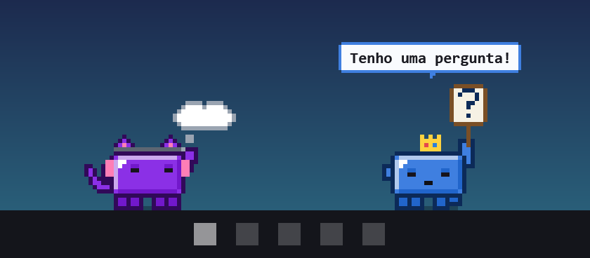
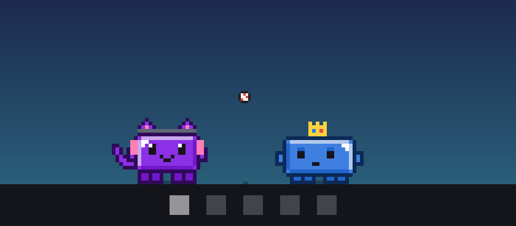

<p align="center"></p>

<h1 align="center">Clawd Companheiro</h1>

<p align="center">
Um mascote em pixel art para cada conta do Claude, em cima da barra de tarefas, e uma janela com todas as sessões, estatísticas, temas e avisos.<br>
Para Windows, com uma ou várias contas do Claude Desktop.
</p>

<p align="center">
<a href="https://github.com/alexzjss/clawd-companheiro/releases/latest/download/ClawdSetup.exe"><b>Baixar o instalador (ClawdSetup.exe)</b></a>
</p>

<p align="center"></p>

> Projeto de fã, sem vínculo com a Anthropic. O personagem é um desenho próprio no estilo de bloquinhos.

## O que vem

| Parte | O que faz |
| --- | --- |
| **Clawd Companheiro** | Um programa só, que fica na bandeja do Windows: os Clawds em cima da barra de tarefas, avisos quando uma sessão precisa de você e uma janela com Home, Estatísticas, Contas e Configurações. |
| **Mod do Claude Code** | Conta ao app o que cada sessão faz, aplica o tema da conta e põe um Clawd dentro do Claude (indicador de trabalho, fundo da conversa e painel `/clawd`). |

Nada vem definido de fábrica: as contas são as que existem na sua máquina, e nomes, e-mails, cores e skins são você quem escolhe.

## Instalar

Precisa de Windows 10 ou 11 e do Claude Desktop.

1. Baixe e abra o **[ClawdSetup.exe](https://github.com/alexzjss/clawd-companheiro/releases/latest/download/ClawdSetup.exe)**. O instalador vai em passos: confere se o Claude Desktop e o Claude Code estão na máquina, pergunta se o app abre com o Windows e se deve criar um atalho na área de trabalho, e **instala o mod do Claude Code sozinho** quando acha o Claude Code. Ele não é assinado, então o Windows pode pedir confirmação ("Mais informações" → "Executar assim mesmo").
2. Reinicie o Claude, para o mod carregar.

Se o instalador não achar o Claude Code, dá para instalar o mod depois em **Configurações → Mod do Claude Code**, ou dentro do Claude Code:

```
/plugin install clawd-companheiro --marketplace alexzjss/clawd-companheiro
```

**Atualizar:** o app procura versão nova no GitHub (ao abrir e a cada 12 horas), avisa pela bandeja e atualiza com um clique; o instalador baixado é conferido pelo SHA-256 publicado na release, e o mod é atualizado junto. Rodar um instalador novo por cima também funciona. Quem tem a versão 1.1 ou anterior (que ainda não se atualizava sozinha) baixa o instalador novo uma vez; ele tira os programas antigos (`ClawdDesktop.exe` e `ClawdCentral.exe`) e mantém as suas escolhas.

`ClawdSetup.exe /quiet` instala sem perguntar e `/uninstall` remove. Suas escolhas (`~/.claude/clawd/config.json`, as skins e o histórico) só são apagadas se você pedir, na desinstalação pelo assistente.

## O app

O Clawd Companheiro fica na bandeja, perto do relógio. Clique no ícone para abrir a janela; o botão direito tem atalhos para as páginas, ligar e desligar os Clawds da barra, o modo não perturbe, as atualizações e Sair. Fechar a janela não fecha o app. `Ctrl+1` a `Ctrl+4` trocam de página.

### Home

Todas as sessões de todas as contas numa tela só, em cartões: o que cada uma está fazendo, há quanto tempo, modelo, subagentes, contexto e custo. Quem está esperando você aparece primeiro, e dá para filtrar por "Ativas", "Esperando você" e por conta. Embaixo ficam os limites de uso de cada conta.

**Com a Home aberta, os Clawds saem de cima da barra de tarefas e pulam para dentro dela**, num cenário que acompanha a hora do dia. Lá eles brincam mais vezes, vêm correndo quando você clica no chão, e passar o mouse num Clawd acende o cartão da sessão dele (clicar num cartão faz o Clawd da sessão dar um alô). Minimizou, fechou ou trocou de página, eles voltam para a barra.

### Estatísticas

O app guarda um resumo de cada dia em `~/.claude/clawd/historico.json`: custo, tempo trabalhando, sessões, tarefas concluídas e com erro, ferramentas usadas (por tipo: git, testes, edição, web...) e os horários. A página mostra 7, 30 ou 90 dias, de todas as contas ou de uma, comparando com o período anterior. Os números começam a contar quando o app passa a rodar.

### Contas

As instâncias do Claude abertas e com quantas sessões; abrir, fechar e criar conta. Em cada conta:

- **Geral:** os e-mails da conta (domínios como `empresa.com` ou e-mails inteiros, separados por vírgula; `*` fica com todos os outros). É assim que cada sessão sabe de qual conta é. Com uma conta só, ela já vem com `*`.
- **Tema do Claude:** desligado até você ligar. Temas prontos ou seis cores à escolha, com prévia nos modos claro e escuro; sessões abertas trocam em alguns segundos.
- **Clawd:** cor do corpo e dos detalhes, skin do Clawd grande e dos filhotes, chapéu do modelo.


Ter mais de uma conta do Claude Desktop aberta ao mesmo tempo depende do Claude Profile Switcher; o app lista os perfis dele e cria contas novas por ele. Com uma conta só, ele não é necessário.

### Configurações

- **Clawds:** na barra de tarefas ou não, canto da tela, brincadeiras.
- **Avisos:** quando uma sessão termina (só as que levaram mais que um tempo mínimo), dá erro ou espera você (pergunta, plano ou permissão). Clicar no aviso abre o Claude da conta. Não avisa o que você já está vendo: a Home aberta ou o Claude da conta na frente. Tem modo não perturbe por 1 hora ou até amanhã.
- **Mod do Claude Code:** se está instalado e em qual versão; instalar ou atualizar com um clique.
- **Sistema:** abrir com o Windows, procurar atualizações sozinho, versão.

## Os Clawds em ação

| | |
| --- | --- |
|  |  |
| **Cada ferramenta, uma animação.** Terminal (git, testes, instalação, compilação, Docker, rede), leitura e edição por tipo de arquivo, web, plano, skills. | **Esperando você.** Pergunta, plano para aprovar ou pedido de permissão; ao lado, uma sessão pensando. |
|  |  |
| **Terminou ou deu erro.** Também há reações para sessão interrompida e pedido recusado. | **Várias sessões.** Cada sessão extra da conta vira um filhote, subagentes viram robozinhos e o chapéu indica o modelo. |
|  |  |
| **Sem sessão ativa**, descansam e dormem. | **Com sessões livres**, de tempo em tempo brincam: bola, pega-pega, corrida, cabo de guerra, cavalinho e outros. |

Passe o mouse num Clawd da barra para ver as sessões da conta, os limites de uso e o custo do dia:

<p align="center"></p>

Clique faz carinho, duplo clique abre o Claude da conta, arrastar levanta o Clawd e o botão direito abre o menu. Para ver tudo sem esperar, `Clawd.exe --demo` passa pelos estados e `--eventos` pelas brincadeiras.

## Criar skins

Cada `.json` em `~/.claude/clawd/skins/` vira uma skin no app (há um exemplo em [`skins/`](skins/)). Uma skin é uma lista de peças de pixel art presas a um ponto do corpo:

```json
{
  "nome": "Cartola",
  "partes": [
    { "camada": "frente", "ancora": "topo", "x": -5, "y": -7,
      "arte": ["..xxxxxx..", "..xxxxxx..", "..xxxxxx..", "..xxxxxx..", "..aaaaaa..", "xxxxxxxxxx"] }
  ]
}
```

- `camada`: `tras` (atrás do corpo), `corpo` (por cima do corpo, sob o rosto) ou `frente`.
- `ancora`: `topo` ou `base` (x=0 é o centro), `costas` ou `frente` (a borda do corpo), `corpo` (o canto de cima).
- `arte`: uma letra por pixel; `.` é transparente. `b l d k a` são corpo, brilho, sombra, contorno e detalhe (mudam com a conta). As outras cores estão no `LEIA-ME.txt` que o app deixa na pasta de skins.

O corpo tem 16 pixels de largura (x de -8 a 7) e 9 de altura. As skins de fábrica estão em `desktop/ClawdConfig.cs`.

## Privacidade

Tudo fica na sua máquina, em `~/.claude/clawd/`. O mod grava ali só o estado de cada sessão, a categoria do que ela faz (por exemplo "git" ou "código") e quantas vezes usou cada ferramenta, nunca o comando, o caminho ou o conteúdo. O histórico das estatísticas guarda só somas por dia e por conta. A única coisa que sai da máquina é a consulta de versão nova à API do GitHub, que dá para desligar em Configurações.

## Desenvolver

```
VERSION             a versão de tudo (o plugin.json precisa estar igual)
hooks/              o mod (TypeScript): register.tsx, themes.ts, sprites.ts
types/              o contrato de estado do mod
desktop/            o app (C# 5, WPF, sem dependências)
  ClawdApp.cs         início, bandeja, janela e Configurações
  ClawdDesktop.cs     os Clawds (o palco, na barra de tarefas ou na Home)
  ClawdHome.cs        a Home
  ClawdHistory.cs     o histórico e as Estatísticas
  ClawdContas.cs      a página Contas
  ClawdServices.cs    bandeja, avisos e atualização automática
  ClawdUi.cs          o visual: cores e controles
  ClawdShared.cs      caminhos, atalhos e o mod (usado também pelo instalador)
  ClawdSetup.cs       o instalador
  ClawdSprite.cs      o desenho do Clawd
  ClawdConfig.cs      config, skins, perfis e cores
  build.ps1           compila; make-icon.ps1 refaz o ícone
install.ps1         instala direto do código, sem o instalador
```

- Compilar o app e o instalador: `powershell -File desktop\build.ps1 -Out dist -Setup` (usa o `csc` do .NET Framework 4 que já vem no Windows).
- Instalar direto do código: `powershell -ExecutionPolicy Bypass -File install.ps1`.
- Testes do mod: `claude plugin test .` e `claude plugin validate .`
- Refazer as imagens deste README, com contas de mentira e sem tocar na tela: `Clawd.exe --fotos docs`. O GitHub Actions faz o mesmo a cada push (artefato "fotos"), o que também testa se o app abre.
- Publicar uma versão: mude `VERSION` e `.claude-plugin/plugin.json`, e envie a tag `vX.Y.Z`. O GitHub Actions confere a versão, compila e publica o `ClawdSetup.exe` e o `ClawdSetup.exe.sha256` na release; os apps instalados acham a versão nova sozinhos.
- A fórmula das cores de fundo do tema existe em dois lugares e precisa andar junta: `surfaces()` em `hooks/themes.ts` e `Tint.Surfaces` em `desktop/ClawdConfig.cs`.

## Licença

[MIT](LICENSE)
