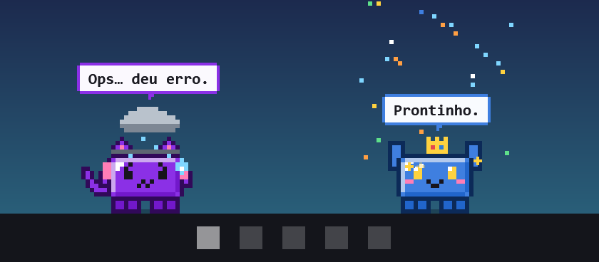
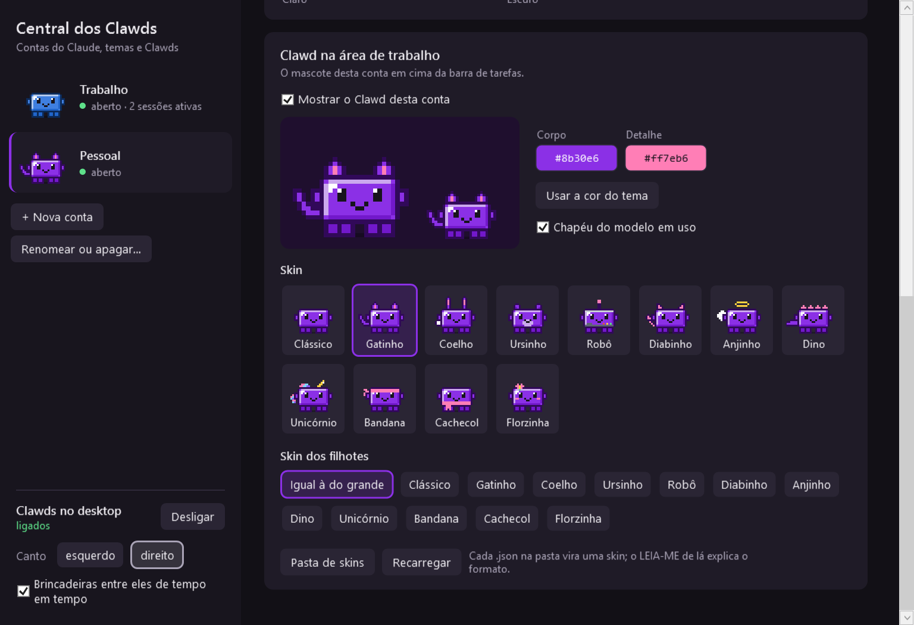

<p align="center"></p>

<h1 align="center">Clawd Companheiro</h1>

<p align="center">
Um mascote em pixel art que mostra, em cima da barra de tarefas, o que cada sessão do Claude está fazendo.<br>
Para Windows, com uma ou várias contas do Claude Desktop.
</p>

<p align="center">
<a href="https://github.com/alexzjss/clawd-companheiro/releases/latest/download/ClawdSetup.exe"><b>Baixar o instalador (ClawdSetup.exe)</b></a>
</p>

<p align="center"></p>

> Projeto de fã, sem vínculo com a Anthropic. O personagem é um desenho próprio no estilo de bloquinhos.

## O que vem

| Parte | O que faz |
| --- | --- |
| **Clawds do desktop** | Um Clawd por conta, pisando na barra de tarefas, com uma animação para cada coisa que a sessão faz. |
| **Central dos Clawds** | O painel de controle: contas, tema do Claude de cada conta, cores e skins dos Clawds. |
| **Mod do Claude Code** | Conta aos Clawds o que cada sessão faz, aplica o tema da conta e põe um Clawd dentro do Claude (indicador de trabalho, fundo da conversa e painel `/clawd`). |

Nada vem definido de fábrica: as contas são as que existem na sua máquina, e nomes, e-mails, cores e skins são você quem escolhe na Central.

## Instalar

Precisa de Windows 10 ou 11 e do Claude Desktop.

1. Baixe e abra o **[ClawdSetup.exe](https://github.com/alexzjss/clawd-companheiro/releases/latest/download/ClawdSetup.exe)**. Ele instala os Clawds e a Central em `~/.claude/clawd/app`, cria os atalhos no menu Iniciar e aparece em "Aplicativos instalados" para remover depois. O instalador não é assinado, então o Windows pode pedir confirmação ("Mais informações" → "Executar assim mesmo").
2. Instale o mod, dentro do Claude Code, e reinicie o Claude:

   ```
   /plugin install clawd-companheiro --marketplace alexzjss/clawd-companheiro
   ```

3. Abra a **Central dos Clawds** e escolha as cores e a skin de cada conta.

Para atualizar, rode o instalador novo por cima. `ClawdSetup.exe /quiet` instala sem perguntar e `/uninstall` remove; suas escolhas (`~/.claude/clawd/config.json` e as skins) nunca são apagadas.

## Os Clawds em ação

| | |
| --- | --- |
|  |  |
| **Cada ferramenta, uma animação.** Terminal (git, testes, instalação, compilação, Docker, rede), leitura e edição por tipo de arquivo, web, plano, skills. | **Esperando você.** Pergunta, plano para aprovar ou pedido de permissão; ao lado, uma sessão pensando. |
|  |  |
| **Terminou ou deu erro.** Também há reações para sessão interrompida e pedido recusado. | **Várias sessões.** Cada sessão extra da conta vira um filhote, subagentes viram robozinhos e o chapéu indica o modelo. |
|  |  |
| **Sem sessão ativa**, descansam e dormem. | **Com sessões livres**, de tempo em tempo brincam: bola, pega-pega, corrida, cabo de guerra, cavalinho e outros. |

Passe o mouse num Clawd para ver as sessões da conta, os limites de uso e o custo do dia:

<p align="center"></p>

Clique faz carinho, duplo clique abre o Claude da conta, arrastar levanta o Clawd e o botão direito abre o menu. Para ver tudo sem esperar, `ClawdDesktop.exe --demo` passa pelos estados e `--eventos` pelas brincadeiras.

## A Central


- **Contas:** quais instâncias do Claude estão abertas e com quantas sessões; abrir, fechar e criar conta.
- **E-mails da conta:** domínios (`empresa.com`) ou e-mails inteiros, separados por vírgula; `*` fica com todos os outros. É assim que cada sessão sabe de qual conta é. Com uma conta só, ela já vem com `*`.
- **Tema do Claude:** desligado até você ligar. Temas prontos ou seis cores à escolha, com prévia nos modos claro e escuro; sessões abertas trocam em alguns segundos.



- **Clawd:** cor do corpo e dos detalhes, skin do Clawd grande e dos filhotes, chapéu do modelo.

Ter mais de uma conta do Claude Desktop aberta ao mesmo tempo depende do Claude Profile Switcher; a Central lista os perfis dele e cria contas novas por ele. Com uma conta só, ele não é necessário.

## Criar skins

Cada `.json` em `~/.claude/clawd/skins/` vira uma skin na Central (há um exemplo em [`skins/`](skins/)). Uma skin é uma lista de peças de pixel art presas a um ponto do corpo:

```json
{
  "nome": "Cartola",
  "partes": [
    { "camada": "frente", "ancora": "topo", "x": -5, "y": -7,
      "arte": ["..xxxxxx..", "..xxxxxx..", "..xxxxxx..", "..xxxxxx..", "..aaaaaa..", "xxxxxxxxxx"] }
  ]
}
```

- `camada`: `tras` (atrás do corpo), `corpo` (por cima do corpo, sob o rosto) ou `frente`.
- `ancora`: `topo` ou `base` (x=0 é o centro), `costas` ou `frente` (a borda do corpo), `corpo` (o canto de cima).
- `arte`: uma letra por pixel; `.` é transparente. `b l d k a` são corpo, brilho, sombra, contorno e detalhe (mudam com a conta). As outras cores estão no `LEIA-ME.txt` que a Central deixa na pasta de skins.

O corpo tem 16 pixels de largura (x de -8 a 7) e 9 de altura. As skins de fábrica estão em `desktop/ClawdConfig.cs`.

## Privacidade

Tudo fica na sua máquina, em `~/.claude/clawd/`. O mod grava ali só o estado de cada sessão e a categoria do que ela faz (por exemplo "git" ou "código"), nunca o comando, o caminho ou o conteúdo. Nada é enviado para fora.

## Desenvolver

```
hooks/              o mod (TypeScript): register.tsx, themes.ts, sprites.ts
types/              o contrato de estado do mod
desktop/            os programas (C# 5, WPF, sem dependências)
  ClawdDesktop.cs     os Clawds da área de trabalho
  ClawdCentral.cs     a Central
  ClawdSetup.cs       o instalador
  ClawdSprite.cs      o desenho do Clawd (nos dois programas)
  ClawdConfig.cs      config, skins, perfis e cores (nos dois programas)
  build.ps1           compila; make-icon.ps1 refaz o ícone
install.ps1         instala direto do código, sem o instalador
```

- Compilar tudo e montar o instalador: `powershell -File desktop\build.ps1 -Out dist -Setup` (usa o `csc` do .NET Framework 4 que já vem no Windows).
- Instalar direto do código: `powershell -ExecutionPolicy Bypass -File install.ps1`.
- Testes do mod: `claude plugin test .` e `claude plugin validate .`
- Refazer as imagens deste README, com contas de mentira e sem tocar na tela: `ClawdDesktop.exe --fotos docs` e `ClawdCentral.exe --fotos docs`.
- Publicar uma versão: acerte o número em `.claude-plugin/plugin.json`, `desktop/ClawdConfig.cs` e `desktop/ClawdSetup.cs`, e envie uma tag `vX.Y.Z`. O GitHub Actions compila e publica o `ClawdSetup.exe` na release.
- A fórmula das cores de fundo do tema existe em dois lugares e precisa andar junta: `surfaces()` em `hooks/themes.ts` e `Tint.Surfaces` em `desktop/ClawdConfig.cs`.

## Licença

[MIT](LICENSE)
