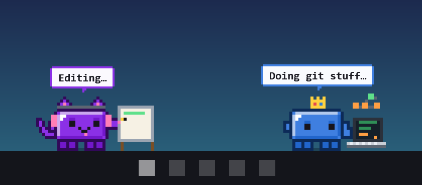
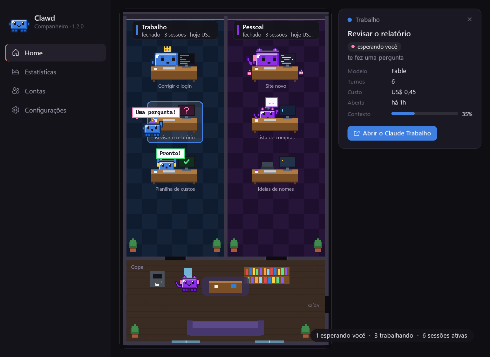
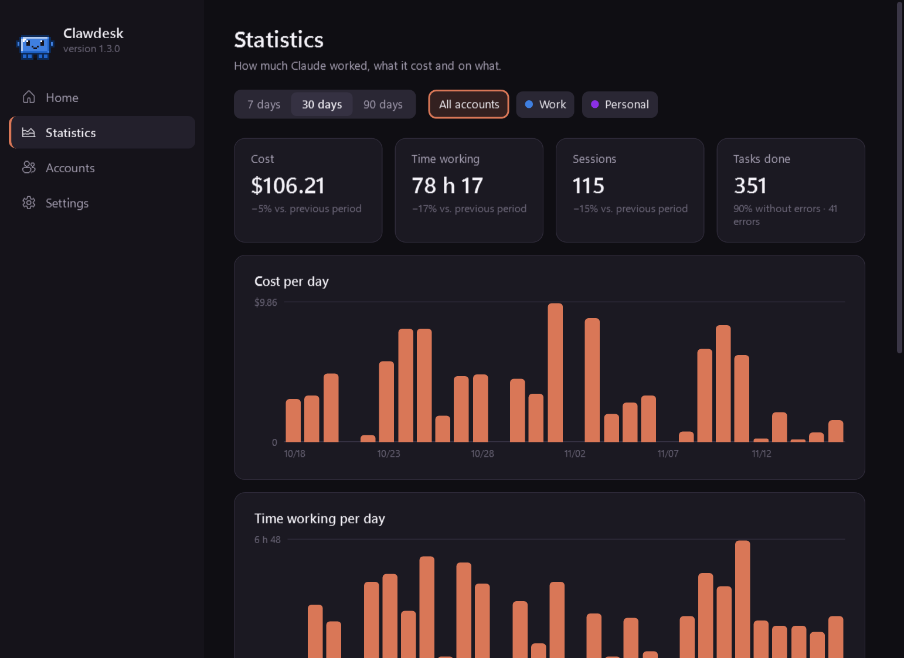
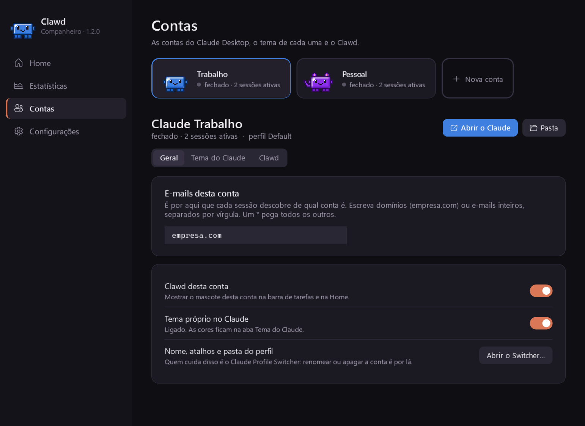
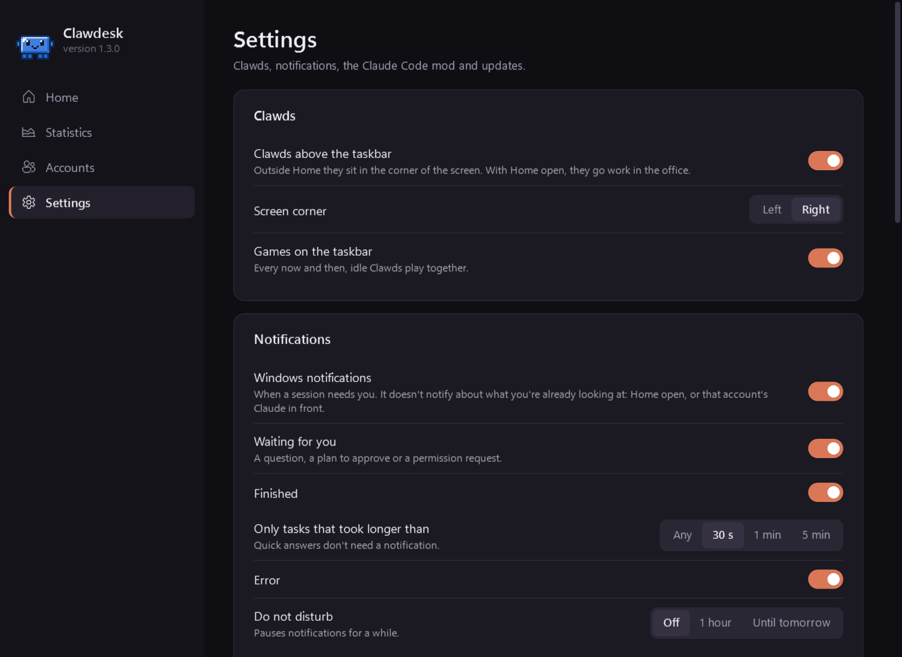
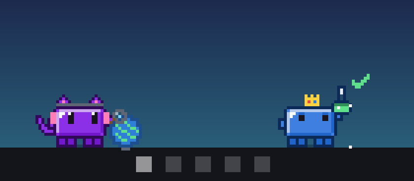
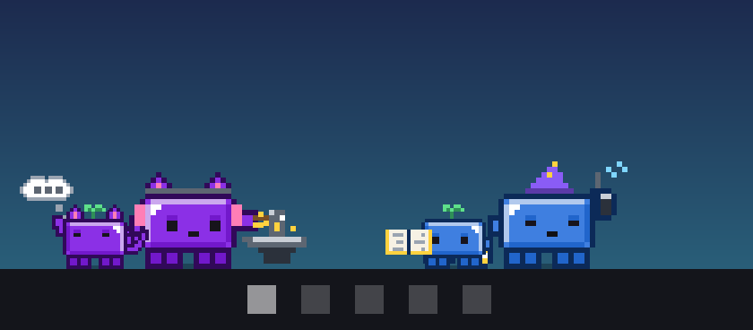
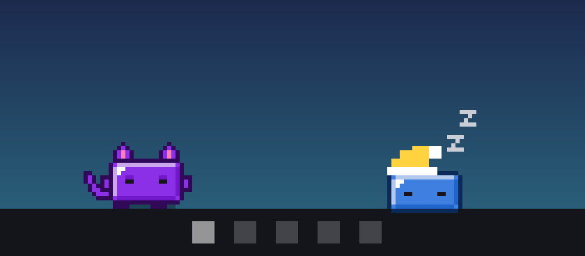
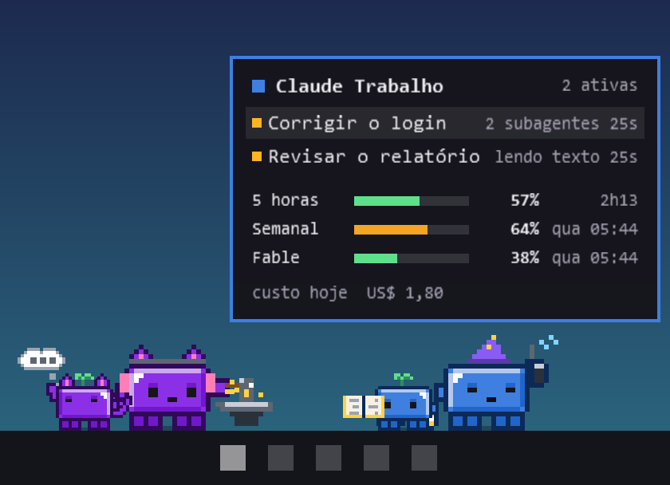

<p align="center"></p>

<h1 align="center">Clawdesk</h1>

<p align="center">
A pixel-art mascot for each Claude account, sitting on your taskbar, plus an office where you can watch every session at work, with statistics, themes and notifications.<br>
For Windows, with one or several Claude Desktop accounts. The app speaks English and Portuguese.
</p>

<p align="center">
<a href="https://github.com/alexzjss/clawdesk/releases/latest/download/ClawdeskSetup.exe"><b>Download the installer (ClawdeskSetup.exe)</b></a>
</p>

<p align="center"></p>

> A fan project, not affiliated with Anthropic. The character is an original drawing in a blocky style.

## What's inside

| Part | What it does |
| --- | --- |
| **Clawdesk** | A single program that lives in the Windows tray: Clawds above the taskbar, notifications when a session needs you, and a window with Home (the office), Statistics, Accounts and Settings. |
| **Claude Code mod** | Tells the app what each session is doing, applies each account's theme and puts a Clawd inside Claude (work indicator, conversation background and the `/clawd` panel). |

Nothing comes preset: the accounts are the ones on your machine, and names, emails, colors and skins are up to you.

## Install

You need Windows 10 or 11 and Claude Desktop.

1. Download and run **[ClawdeskSetup.exe](https://github.com/alexzjss/clawdesk/releases/latest/download/ClawdeskSetup.exe)**. The installer walks you through it: it checks for Claude Desktop and Claude Code, asks whether the app should start with Windows and whether to add a desktop shortcut, and **installs the Claude Code mod for you** when it finds Claude Code. It isn't signed, so Windows may ask for confirmation ("More info" → "Run anyway").
2. Restart Claude so the mod loads.

If the installer doesn't find Claude Code, you can install the mod later in **Settings → Claude Code mod**, or from inside Claude Code:

```
/plugin install clawdesk --marketplace alexzjss/clawdesk
```

**Updates:** the app checks GitHub for a new version (at startup and every 12 hours), lets you know from the tray and updates in one click; the downloaded installer is verified against the SHA-256 published with the release, and the mod is updated too. Running a newer installer over the old one also works.

**Coming from Clawd Companheiro:** Clawdesk is the new name of Clawd Companheiro. The installer removes the old programs, shortcuts and Installed apps entry, and swaps the `clawd-companheiro` mod for `clawdesk`; your accounts, colors, skins and history stay where they were (`~/.claude/clawd`).

`ClawdeskSetup.exe /quiet` installs without asking and `/uninstall` removes it. Your settings (`~/.claude/clawd/config.json`, skins and history) are only deleted if you ask for it in the uninstall wizard.

## The app

Clawdesk sits in the tray, near the clock. Click the icon to open the window; right-click it for shortcuts to each page, turning the taskbar Clawds on or off, do not disturb, updates and Quit. Closing the window doesn't close the app. `Ctrl+1` to `Ctrl+4` switch pages.

**Language:** the app follows the Windows language (Portuguese if Windows is in Portuguese, English otherwise). You can pick one in **Settings → Language**; switching restarts the app. The mod and the installer use the same language.

### Home: the office



Home is a pixel-art office seen from above, filling the whole window. **Each account is a department**: a room with carpet in the account's color and a sign with its name, whether Claude is open, how many sessions are active, today's cost and the usage limits. **Each session is a Clawd at its own desk** (the account's oldest session gets the big Clawd, as on the taskbar):

- **working:** seated and typing; the computer screen shows the kind of work (terminal, code, web, plan, subagents);
- **thinking:** an ellipsis bubble; **done:** celebrates with confetti; **error:** the screen turns red;
- **waiting for you:** stands up and waves, with a question bubble;
- **free:** heads to the break room (coffee, water cooler, bookshelf) or wanders around the room; **asleep:** naps on the couch;
- **subagents** are little robots around the desk;
- a new session walks in through the break-room door to its desk; a session that stopped walks out, and its desk stays empty for a few minutes.

Hover a Clawd or a desk to see the session; click to pet it and open the details (model, subagents, turns, cost, context and a button to open that account's Claude); double-click opens Claude directly. While Home is on screen, the Clawds leave the taskbar and go to work in the office; minimize, close or switch pages and they drop back onto the taskbar.

### Statistics



The app keeps a daily summary in `~/.claude/clawd/historico.json`: cost, time working, sessions, finished tasks and errors, tools used (by type: git, tests, editing, web…) and the hours of the day. The page shows 7, 30 or 90 days, for all accounts or one, compared with the previous period. Numbers start counting once the app is running.

### Accounts



Which Claude instances are open and with how many sessions; open, close and create accounts. For each account:

- **General:** the account's emails (domains such as `company.com` or full emails, separated by commas; `*` catches everything else). This is how each session knows which account it belongs to. With a single account, it starts with `*`.
- **Claude theme:** off until you turn it on. Ready-made themes or six colors of your own, with a light and dark preview; open sessions switch within a few seconds.
- **Clawd:** body and detail colors, skin for the big Clawd and for the pups, model hat.

Having more than one Claude Desktop account open at once relies on Claude Profile Switcher; the app lists its profiles and creates new accounts through it. With a single account you don't need it.

### Settings



- **Clawds:** on the taskbar or not, screen corner, games.
- **Notifications:** when a session finishes (only those that took longer than a minimum time), hits an error or waits for you (question, plan or permission). Clicking the notification opens that account's Claude. It doesn't notify about what you're already looking at: Home open, or that account's Claude in front. Do not disturb for 1 hour or until tomorrow.
- **Claude Code mod:** whether it's installed and which version; install or update in one click.
- **Cloud and other PCs:** the Gist and the token for sessions outside this PC (below).
- **System:** start with Windows, automatic update checks, version.
- **Language:** automatic, Português or English.

## The Clawds in action

| | |
| --- | --- |
|  |  |
| **One animation per tool.** Terminal (git, tests, installs, builds, Docker, network), reading and editing by file type, web, plans, skills. | **Waiting for you.** A question, a plan to approve or a permission request; next to it, a session thinking. |
|  |  |
| **Done or error.** There are also reactions for interrupted sessions and refused requests. | **Several sessions.** Each extra session in the account becomes a pup, subagents become little robots and the hat shows the model. |
|  |  |
| **No active session:** they rest and fall asleep. | **Idle sessions:** every now and then they play: ball, tag, races, tug of war, piggyback rides and more. |

Hover a taskbar Clawd to see the account's sessions, usage limits and today's cost:

<p align="center"></p>

Click to pet, double-click to open that account's Claude, drag to pick the Clawd up and right-click for the menu. To see everything without waiting, `Clawdesk.exe --demo` cycles through the states and `--eventos` through the games.

## Sessions outside this PC

Sessions in the claude.ai cloud (started from the app, the web, your phone or scheduled tasks) and sessions on other computers show up too: they become pups of the account's Clawd, with a little cloud, get a desk in the office, and are marked ☁ (cloud) or ⇄ (another computer). The big Clawd stays with a session from this PC when there is one.

Since they don't write to your disk, they send their status to a **secret GitHub Gist**, and Clawdesk reads it from there. To turn it on:

1. Create a secret Gist with any file, and a GitHub token with only the `gist` permission.
2. In the app, under **Settings → Cloud and other PCs**, paste the Gist address and the token.
3. In the cloud environment (claude.ai/code, environment settings): the variable `CLAWD_GIST_ID=<id>`, `api.github.com` allowed in the network settings, and a network secret for `api.github.com` with the token. The mod must be enabled in the cloud sessions.
4. On another computer with the mod: `CLAWD_GIST_ID` and `CLAWD_GITHUB_TOKEN` in the environment before opening Claude.

A session only sends to the Gist when it runs in the cloud or on a machine without Clawdesk installed; `CLAWD_RELAY=1` forces sending and `CLAWD_RELAY=0` turns it off. Each session sends at most every 20 seconds (GitHub rate-limits writes) and Clawdesk reads every 15 seconds, so what happens there shows up here up to half a minute later. Sessions older than a day leave the Gist on their own.

## Making skins

Each `.json` in `~/.claude/clawd/skins/` becomes a skin in the app (there's an example in [`skins/`](skins/)). A skin is a list of pixel-art pieces pinned to a point on the body:

```json
{
  "name": "Top hat",
  "parts": [
    { "layer": "front", "anchor": "top", "x": -5, "y": -7,
      "art": ["..xxxxxx..", "..xxxxxx..", "..xxxxxx..", "..xxxxxx..", "..aaaaaa..", "xxxxxxxxxx"] }
  ]
}
```

- `layer`: `back` (behind the body), `body` (over the body, under the face) or `front`.
- `anchor`: `top` or `bottom` (x=0 is the center), `back` or `front` (the body edge), `body` (the top corner).
- `art`: one letter per pixel; `.` is transparent. `b l d k a` are body, highlight, shade, outline and detail (they follow the account). The other colors are listed in the `README.txt` the app leaves in the skins folder.

The original Portuguese keys (`nome`, `partes`, `camada`, `ancora`, `arte`; `tras`, `corpo`, `frente`, `topo`, `base`, `costas`) work too. The body is 16 pixels wide (x from -8 to 7) and 9 tall. The built-in skins live in `desktop/ClawdConfig.cs`.

## Privacy

Everything stays on your machine, in `~/.claude/clawd/`. The mod only writes each session's status there, the category of what it's doing (for example "git" or "code") and how many times it used each tool, never the command, the path or the content. The statistics history only keeps per-day, per-account totals. The only things that leave the machine are the new-version check against the GitHub API, which you can turn off in Settings, and the Gist, if you set it up (see above for what goes there).

## Development

```
VERSION             the version of everything (plugin.json must match)
hooks/              the mod (TypeScript): register.tsx, relay.ts (sending to the Gist), themes.ts, sprites.ts
types/              the mod's state contract
desktop/            the app (C# 5, WPF, no dependencies)
  ClawdApp.cs         startup, tray, window and Settings
  ClawdDesktop.cs     the taskbar Clawds
  ClawdHome.cs        Home (the office, the summary and the details)
  ClawdOffice.cs      the office seen from above
  ClawdHistory.cs     the history and Statistics
  ClawdContas.cs      the Accounts page
  ClawdServices.cs    tray, notifications and automatic updates
  ClawdUi.cs          the look: colors and controls
  ClawdShared.cs      paths, shortcuts, language and the mod (also used by the installer)
  ClawdeskSetup.cs    the installer
  ClawdSprite.cs      the Clawd drawing
  ClawdConfig.cs      config, skins, profiles and colors
  build.ps1           builds everything; make-icon.py redraws the icon
install.ps1         installs straight from source, without the installer
```

- Build the app and the installer: `powershell -File desktop\build.ps1 -Out dist -Setup` (uses the .NET Framework 4 `csc` that ships with Windows).
- Install from source: `powershell -ExecutionPolicy Bypass -File install.ps1`.
- Mod tests: `claude plugin test .` and `claude plugin validate .`
- Redraw the README images with fake accounts, without touching the screen: `Clawdesk.exe --fotos docs` (add `--idioma pt` or `--idioma en` to pick the language). GitHub Actions does the same on every push (the "fotos" artifact), which also checks that the app starts.
- Redraw the icon: `python desktop/make-icon.py` (needs Pillow).
- Text in the app goes through `L.T("português", "English")`, in `desktop/ClawdShared.cs`; in the mod, through `tx()`.
- Publish a version: bump `VERSION` and `.claude-plugin/plugin.json`, then push a `vX.Y.Z` tag. GitHub Actions checks the version, builds, and publishes `ClawdeskSetup.exe` and `ClawdeskSetup.exe.sha256` to the release; installed apps find the new version on their own.
- The theme background color formula lives in two places and must stay in sync: `surfaces()` in `hooks/themes.ts` and `Tint.Surfaces` in `desktop/ClawdConfig.cs`.

## License

[MIT](LICENSE)
