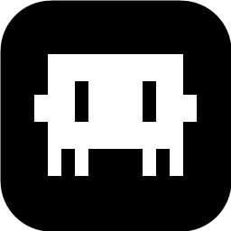
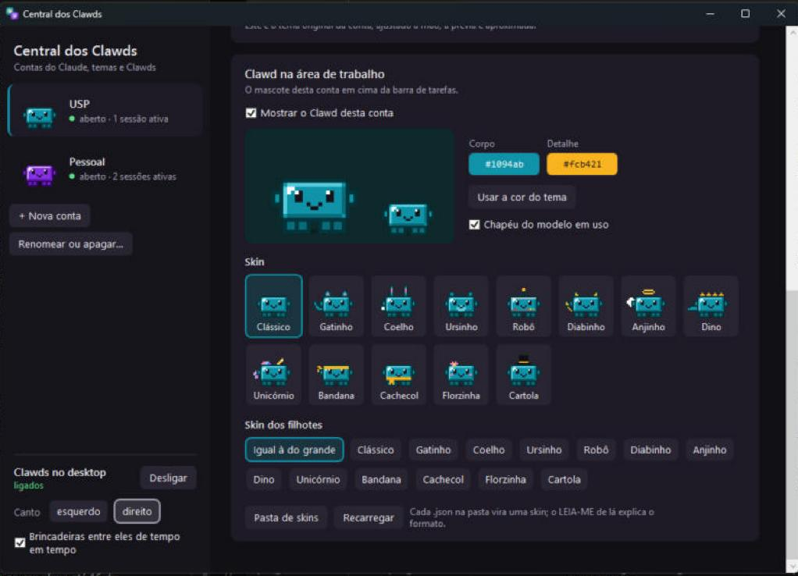

<p align="center"></p>

# Clawd Companheiro

Um mascote em pixel art para quem usa o Claude Desktop no Windows com uma ou mais contas. São três partes que conversam por uma pasta compartilhada (`~/.claude/clawd/`):

| Parte | O que faz |
| --- | --- |
| **Mod** (`hooks/`) | Dentro do Claude: um Clawd no indicador de trabalho, no fundo da conversa e no painel `/clawd`; aplica o tema da conta. |
| **Clawds do desktop** (`ClawdDesktop.exe`) | Um Clawd por conta em cima da barra de tarefas, com uma animação para cada coisa que a sessão faz. |
| **Central dos Clawds** (`ClawdCentral.exe`) | O painel de controle: contas, cores do tema, cores e skins dos Clawds. |



> Projeto de fã, sem vínculo com a Anthropic. O personagem é um desenho próprio no estilo de bloquinhos.

## Instalar

Precisa de Windows 10 ou 11 e do Claude Desktop. Nada mais: os programas são compilados com o .NET Framework 4 que já vem no Windows.

**1. O mod**, dentro do Claude Code:

```
/plugin install clawd-companheiro --marketplace alexzjss/clawd-companheiro
```

**2. Os programas da área de trabalho**, no PowerShell, a partir desta pasta:

```powershell
powershell -ExecutionPolicy Bypass -File install.ps1
```

O instalador compila os dois programas em `~/.claude/clawd/app/`, cria os atalhos **Clawd** e **Central dos Clawds** no menu Iniciar e põe os Clawds para abrir com o Windows (`-NoStartup` para não abrir). Para remover: `install.ps1 -Uninstall`.

Para ter mais de uma conta do Claude Desktop ao mesmo tempo, a Central usa os perfis do Claude Profile Switcher; com uma conta só, ele não é necessário.

## Os Clawds do desktop

- Ficam numa faixa no canto da tela, pisando na borda da barra de tarefas.
- Cada ferramenta tem a sua animação: terminal (git, testes, instalação, compilação, Docker, rede...), leitura e edição por tipo de arquivo, web, subagentes, plano, skills.
- Mostram quando a sessão espera você (pergunta, plano para aprovar, permissão), pensa, resume a conversa, termina, erra, é interrompida ou recusa.
- O chapéu indica o modelo em uso; subagentes viram robozinhos; cada sessão extra da conta vira um filhote.
- Sem sessão ativa, descansam e dormem. Com sessões livres, de tempo em tempo brincam entre si (pega-pega, bola, corrida, cabo de guerra e outros).
- Passe o mouse para ver sessões, limites de uso e custo do dia. Clique faz carinho, duplo clique abre o Claude da conta, botão direito abre o menu.

Para ver tudo sem esperar: `ClawdDesktop.exe --demo` passa pelos estados e `--eventos` pelas brincadeiras.

## A Central

- **Contas:** quais instâncias do Claude estão abertas e com quantas sessões; abrir, fechar e criar conta.
- **E-mails da conta:** domínios (`empresa.com`) ou e-mails inteiros, separados por vírgula; `*` fica com todos os outros. É assim que cada sessão sabe de qual conta é.
- **Tema do Claude:** temas prontos ou seis cores à escolha, com prévia nos modos claro e escuro. Sessões abertas trocam em alguns segundos.
- **Clawd:** cor do corpo e dos detalhes, skin do Clawd grande e dos filhotes.

Tudo é gravado em `~/.claude/clawd/config.json`.

## Criar skins

Cada `.json` em `~/.claude/clawd/skins/` vira uma skin na Central (há um exemplo em [`skins/`](skins/)). Uma skin é uma lista de peças de pixel art presas a um ponto do corpo:

```json
{
  "nome": "Cartola",
  "partes": [
    { "camada": "frente", "ancora": "topo", "x": -5, "y": -7,
      "arte": ["..xxxxxx..", "..xxxxxx..", "..xxxxxx..", "..xxxxxx..", "..aaaaaa..", "xxxxxxxxxx"] }
  ]
}
```

- `camada`: `tras` (atrás do corpo), `corpo` (por cima do corpo, sob o rosto) ou `frente`.
- `ancora`: `topo` ou `base` (x=0 é o centro), `costas` ou `frente` (a borda do corpo), `corpo` (o canto de cima).
- `arte`: uma letra por pixel; `.` é transparente. `b l d k a` são corpo, brilho, sombra, contorno e detalhe (mudam com a conta). As outras cores estão no `LEIA-ME.txt` que a Central deixa na pasta de skins.

O corpo tem 16 pixels de largura (x de -8 a 7) e 9 de altura. As skins de fábrica estão em `desktop/ClawdConfig.cs`.

## Desenvolver

```
hooks/            o mod (TypeScript): register.tsx, themes.ts, sprites.ts
types/            o contrato de estado do mod
desktop/          os programas (C# 5, WPF)
  ClawdDesktop.cs   os Clawds da área de trabalho
  ClawdCentral.cs   a Central
  ClawdSprite.cs    o desenho do Clawd (nos dois programas)
  ClawdConfig.cs    config, skins, perfis e cores (nos dois programas)
  build.ps1         compila; make-icon.ps1 refaz o ícone
```

- Testes do mod: `claude plugin test .` e `claude plugin validate .`
- Programas: `powershell -File desktop\build.ps1` (feche-os antes).
- A fórmula das cores de fundo do tema existe em dois lugares e precisa andar junta: `surfaces()` em `hooks/themes.ts` e `Tint.Surfaces` em `desktop/ClawdConfig.cs`.

O mod grava em `sessions/` só o estado da sessão e a categoria do que ela faz (por exemplo "git" ou "código"), nunca o comando, o caminho ou o conteúdo.

## Licença

[MIT](LICENSE)
